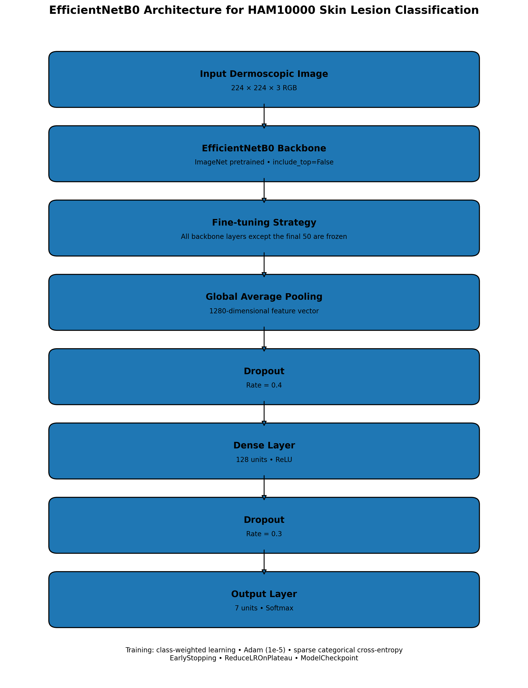
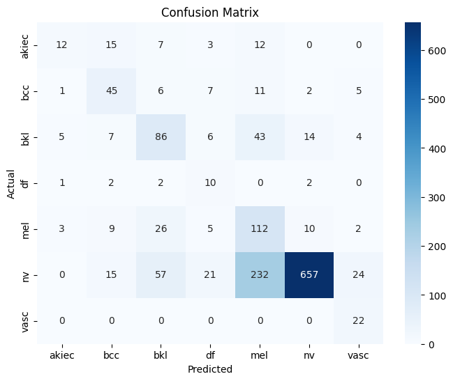
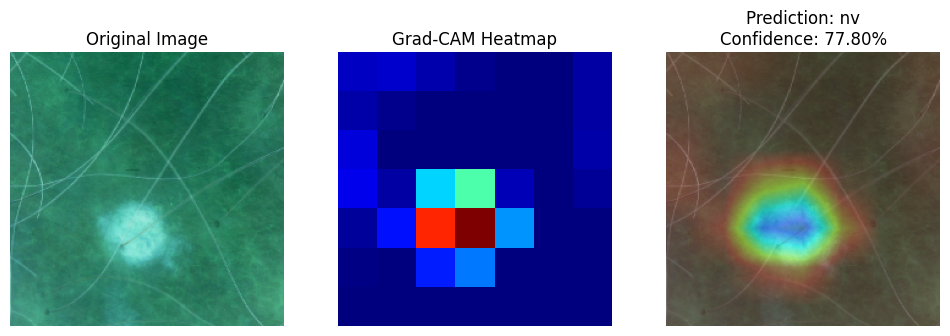

# Imbalance-Aware Skin Lesion Classification on HAM10000

**EfficientNetB0 Transfer Learning with Grad-CAM Explainability**

An experimental deep-learning project for classifying seven categories of skin lesions from dermoscopic images in the HAM10000 dataset. The workflow combines transfer learning, image augmentation, class-weighted training, model evaluation, and Grad-CAM visualization.

> **Medical disclaimer:** This is an academic and educational experiment, not a medical device. It must not be used for diagnosis, screening, treatment decisions, or clinical care.

## Project Overview

HAM10000 contains 10,015 dermoscopic images across seven diagnostic categories. The dataset is strongly imbalanced, with melanocytic nevi (NV) representing most of the images.

This project uses an ImageNet-pretrained EfficientNetB0 model to explore seven-class skin lesion classification. Class weights are used during training to address the imbalanced class distribution. Grad-CAM provides a qualitative visualization of image regions associated with a selected model prediction.

## Key Features

- Seven-class classification: AKIEC, BCC, BKL, DF, MEL, NV, and VASC
- ImageNet-pretrained EfficientNetB0
- 224 × 224 RGB image input
- Training-time image augmentation
- Balanced class-weighted learning
- Early stopping and learning-rate reduction
- Accuracy, precision, recall, F1-score, confusion matrix, and one-vs-rest ROC curves
- Grad-CAM heatmap visualization

## Dataset

**Dataset:** HAM10000  
**Total images:** 10,015  
**Metadata file:** `HAM10000_metadata.csv`

| Class | Description | Images |
|---|---|---:|
| AKIEC | Actinic keratoses / intraepithelial carcinoma | 327 |
| BCC | Basal cell carcinoma | 514 |
| BKL | Benign keratosis-like lesions | 1,099 |
| DF | Dermatofibroma | 115 |
| MEL | Melanoma | 1,113 |
| NV | Melanocytic nevi | 6,705 |
| VASC | Vascular lesions | 142 |
| **Total** | | **10,015** |

### Original Source and Download Links

The raw image dataset is **not included** in this GitHub repository. Download it separately from one of the following sources:

1. **Original dataset record — Harvard Dataverse:**  
   https://dataverse.harvard.edu/dataset.xhtml?persistentId=doi:10.7910/DVN/DBW86T

2. **Alternative mirror — Kaggle:**  
   https://www.kaggle.com/datasets/kmader/skin-cancer-mnist-ham10000

### Dataset Setup

After downloading and extracting the dataset, arrange the files as follows:

```text
HAM10000/
├── HAM10000_metadata.csv
├── HAM10000_images_part_1/
│   └── *.jpg
└── HAM10000_images_part_2/
    └── *.jpg
```

If the downloaded image archives are compressed, extract both image parts into the same dataset directory as the metadata file. The notebook expects the metadata CSV and both image folders to be accessible from the dataset root.

## Methodology

1. Load the HAM10000 metadata and locate the corresponding images in both image folders.
2. Encode the seven diagnostic categories.
3. Create stratified training, validation, and test subsets using an image-level 70:15:15 split (`random_state=42`).
4. Resize images to 224 × 224 and apply augmentation to training images.
5. Calculate balanced class weights from the training labels.
6. Train and fine-tune an ImageNet-pretrained EfficientNetB0 model.
7. Evaluate the selected checkpoint using class-wise metrics, a confusion matrix, and one-vs-rest ROC curves.
8. Generate a Grad-CAM visualization for an example prediction.

### Model Architecture

The model uses an ImageNet-pretrained EfficientNetB0 backbone. All backbone layers except the final 50 are frozen during fine-tuning. The classification head consists of:

- Global Average Pooling
- Dropout (0.4)
- Dense layer (128 units, ReLU)
- Dropout (0.3)
- Dense output layer (7 units, Softmax)



### Training Configuration

| Setting | Value |
|---|---|
| Input size | 224 × 224 × 3 |
| Batch size | 32 |
| Maximum epochs | 30 |
| Optimizer | Adam |
| Learning rate | 0.00001 |
| Loss | Sparse categorical cross-entropy |
| Imbalance handling | Balanced class weights |
| Early stopping | `val_loss`, patience 6 |
| Learning-rate reduction | `val_loss`, patience 3 |

## Experimental Results

The following results are taken from the saved notebook execution and accompanying result files. They are **not** the outcome of a new training run during repository preparation.

| Metric | Test result |
|---|---:|
| Test loss | 0.9673 |
| Test accuracy | **62.81%** |
| Weighted precision | 0.77 |
| Weighted recall | 0.63 |
| Weighted F1-score | 0.67 |
| Macro F1-score | 0.48 |
| Correct predictions | 944 / 1,503 |

The difference between weighted F1-score (0.67) and macro F1-score (0.48) indicates weaker performance on some underrepresented classes.

### Class-wise Performance

| Class | Precision | Recall | F1-score | Support |
|---|---:|---:|---:|---:|
| AKIEC | 0.55 | 0.24 | 0.34 | 49 |
| BCC | 0.48 | 0.58 | 0.53 | 77 |
| BKL | 0.47 | 0.52 | 0.49 | 165 |
| DF | 0.19 | 0.59 | 0.29 | 17 |
| MEL | 0.27 | 0.67 | 0.39 | 167 |
| NV | 0.96 | 0.65 | 0.78 | 1,006 |
| VASC | 0.39 | 1.00 | 0.56 | 22 |

### Confusion Matrix



### Grad-CAM Explainability

Grad-CAM provides a qualitative heatmap of image regions associated with a selected model prediction. It does not prove that the model focuses on medically meaningful features or that its prediction is correct.



## Project Structure

```text
HAM10000-Skin-Lesion-Classification/
│
├── ham10000_skin_lesion_classification.ipynb
├── README.md
├── requirements.txt
├── .gitignore
│
├── assets/
│   ├── model_architecture.png
│   ├── confusion_matrix.png
│   └── gradcam_visualization.png
│
└── results/
    ├── classification_report.csv
    ├── confusion_matrix.csv
    └── test_metrics_summary.csv
```

## Installation

Use Python 3.10–3.12.

```bash
pip install -r requirements.txt
```

## How to Run

### Option 1: Kaggle Notebook

1. Create or open a Kaggle Notebook.
2. Add the HAM10000 dataset to the notebook.
3. Upload or open `ham10000_skin_lesion_classification.ipynb`.
4. Run the notebook cells from top to bottom.

The notebook checks the common Kaggle dataset location automatically.

### Option 2: Local Jupyter Notebook

1. Download and extract HAM10000 using the folder structure shown in the Dataset section.
2. Install the dependencies:

   ```bash
   pip install -r requirements.txt
   ```

3. Set `HAM10000_DATASET_DIR` to the directory containing `HAM10000_metadata.csv`.

   **Windows PowerShell:**

   ```powershell
   $env:HAM10000_DATASET_DIR="C:\path\to\HAM10000"
   jupyter notebook
   ```

   **macOS / Linux:**

   ```bash
   export HAM10000_DATASET_DIR="/path/to/HAM10000"
   jupyter notebook
   ```

4. Open `ham10000_skin_lesion_classification.ipynb` and run all cells.

The best model checkpoint is saved to `outputs/best_model.keras` when the notebook is run. Dataset files and generated model checkpoints are excluded from Git by `.gitignore`.

## Limitations

- **Image-level split:** The split is performed by image, not by unique lesion ID. Images of the same lesion may therefore appear in different subsets, creating potential identity leakage.
- **Class imbalance:** Class weighting does not fully resolve the low sample counts and weaker recognition of minority classes.
- **No external validation:** The experiment uses HAM10000 only; performance on independent datasets has not been established.
- **No clinical validation:** The model is not suitable for medical diagnosis, screening, or treatment decisions.
- **Grad-CAM is qualitative:** Heatmaps do not establish causal reasoning, diagnostic reliability, or correct localization.

## Repository Contents

This repository contains the notebook, dependency list, selected evaluation outputs, and only the visual assets needed to understand the model and its results. The raw HAM10000 dataset and trained model checkpoint are not included.
